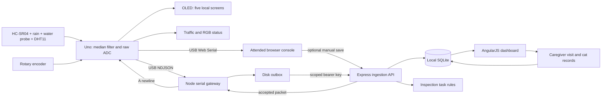

# Architecture and API contract

## Complete path



`server/index.js` starts a loopback-only listener and a 30-second monitor tick. `server/app.js` exposes an app factory so tests can use isolated in-memory databases and ephemeral ports. `Store` contains SQL access; `domain.js` holds validation, calibration, normalization, and alert rules. The AngularJS client polls `/api/state` every five seconds and refreshes after writes.

SQLite stores colonies, devices, individual cats, tasks, visits, observations, and a time-ordered reading ledger. Telemetry is indexed by device/time and uniquely identified by `(device_id, boot_id, sequence)`. Human writes use transactions when multiple records change. Reading insertion, last-seen metadata, and resulting tasks are committed together.

A production database migration must also make the routes asynchronous; replacing the SQLite path alone is insufficient. The local process is synchronous at the persistence boundary and is intended for a small pilot, not multiple concurrent server instances.

## Sensor frame and gateway envelope

Firmware emits one JSON line every ten seconds. Example:

```json
{"schemaVersion":1,"sequence":42,"uptimeMs":430000,"sonarDistanceCm":20.0,"sonarValidSamples":5,"rainAnalog":900,"rainDigital":1,"waterAnalog":100,"temperatureC":26.0}
```

A boot event with `event: "boot"` is informative and ignored by the gateway. No free-form diagnostic text is required on the telemetry channel.

The gateway adds:

```json
{
  "deviceId": "CW-example",
  "bootId": "gateway-generated-session-uuid",
  "sampledAt": "2026-11-07T20:00:00.000Z"
}
```

It uses `gateway/protocol.js` to validate the completed packet, then appends it to the on-disk outbox before attempting delivery. Device identity and the current session overwrite any corresponding fields in an incoming serial frame. `sampledAt` is the gateway's **USB receipt time**, not an RTC timestamp measured by the Uno. It is preserved during network retries. The gateway generates a new boot/session identity when the serial port opens or sequence numbering moves backward.

API constraints:

- `schemaVersion` exactly 1; nonempty `deviceId`/`bootId`, at most 80 characters.
- `sequence` and `uptimeMs`: integers from 0 through 2³²−1.
- `sampledAt`: within the past seven days and at most five minutes ahead of service time.
- `sonarDistanceCm`: 2–400, with at least three valid samples; otherwise `null` with fewer than three valid samples.
- `sonarValidSamples`: 0–5; rain/water ADC: integers 0–1023; rain DO: 0 or 1.
- `temperatureC`: finite Celsius from −20 to 60 for supported DHT11 revisions, or `null` on failed reads. Missing fields from older schema-v1 firmware normalize to `null`. Verify module rating; common DHT11s only support 0–50°C.
- The server assigns provenance: a provisioned physical device is `hardware`, while a fictional demo device is `simulation`. A client cannot promote itself to physical provenance by sending a `source` property.

A success response is HTTP 202:

```json
{"accepted":true,"duplicate":false}
```

An idempotent retry returns `duplicate: true` without inserting another reading or task. The first stored reading for a tuple wins. New boot IDs allow sequence numbering to restart. Reading selection uses sample time, so uploading an older backlog cannot overwrite a newer current measurement.

The gateway removes a packet only after an accepted response. Writes are flushed to its journal; acknowledgements atomically replace the queue file. A crash after server acceptance but before local acknowledgement produces a safe replay. Exponential retry increases from one to thirty seconds. Bad credentials and expired oldest packets remain visible to the operator; they are not silently deleted. Queue files contain readings, not the bearer key. There is no maximum queue size or automatic disk management in this pilot.

The hardware dashboard at `/` is an alternative serial owner (`/serial.html` redirects there). Colony management remains available at `/colonies.html`. The device interface parses the same schema and uses `HELLO`, `STREAM`, and `SAMPLE` command lines. Extra firmware fields provide calibrated food/water values, rain state, encoder/button state, and the OLED page. Browser viewing sends `B`; only an accepted optional manual save sends `A`. Browser receipts are timestamped when acquired, and manual saves use the same API/deduplication contract. The console does not automatically upload or maintain a durable outbox. See [browser serial protocol and operation](BROWSER_SERIAL.md).

A network interruption with the gateway running is buffered. A dead gateway, disconnected USB link, or board power loss cannot be reconstructed later: the Uno has no durable measurement log. Reopening serial can reset an Uno; a new gateway session prevents sequence collisions.

## Connectivity and task rules

| Condition | Current view / task |
| --- | --- |
| New accepted packet within 120 seconds, lifecycle deployed | Station online |
| No new packet for 120 seconds | Current gauges unknown; connection check |
| Latest sample older than 5 minutes | Unknown values; delayed-data check |
| Valid food estimate at/below the configured threshold | Food inspection/refill task |
| Fewer than 3 valid sonar samples | Unknown food; inspect sonar |
| Rain DO in configured wet state | Check shelter / food protection |
| Water wetness index at/above configured threshold | Inspect local standing water |
| Temperature ≥32°C | Urgent heat care check |
| Temperature >0°C and ≤7°C | Cold care warning |
| Temperature ≤0°C | Urgent freezing care check |
| Thermometer absent or failed on a fresh packet | Unknown temperature; inspect DHT11 |
| New human-entered cat identity | Identity/TNVR review task |
| Human observation marked for follow-up | Caregiver review task |

The default food threshold is 25%; water threshold is 60 on the normalized wetness index. Temperature defaults and sensor limits are described in the [DHT11 guide](HARDWARE.md#dht11-thermometer-on-d7). Thresholds are prototype operational defaults. No rule diagnoses an animal, confirms a flood, certifies a safe route, counts cats, or automatically operates a feeder/trap.

Each active sensor task is deduplicated per device/type. Assignment and completion are caregiver actions, independent of whether a reading has recovered. A completed task suppresses another task of the same type for thirty minutes; a continuing condition can then create another check. Events and visits remain stored for review. The current pilot has no automated SMS/email dispatcher or push-notification service.

## HTTP routes

| Method / path | Purpose |
| --- | --- |
| `GET /api/health` | Local process/storage mode/time health response |
| `GET /api/state` | Joined workspace snapshot, safe device metadata, and recent histories |
| `GET /api/care-demo` | Persistent isolated fictional rescue exercise |
| `POST /api/care-demo/import` | Idempotently receive six annotated sample updates |
| `POST /api/care-demo/updates` | Receive a fictional phone note for review |
| `POST /api/care-demo/updates/:id/review` | Human identity/alias, new identity, colony note, dismissal or procedure review |
| `PATCH /api/care-demo/tasks/:id` | Assign a follow-up or complete it with a dated care visit |
| `POST /api/care-demo/station` | Persist a sample reading and create any required human follow-up |
| `POST /api/care-demo/visits` | Save a fictional care visit independently of sensor/census changes |
| `PATCH /api/care-demo/preparedness` | Save the exercise's readiness/people/food plan |
| `PATCH /api/care-demo/pilot` | Save entered equipment/operation budget and maintenance assumptions |
| `GET /api/care-demo/report[.csv]?from=YYYY-MM-DD&to=YYYY-MM-DD` | Inclusive UTC activity report and original-source evidence export |
| `POST /api/care-demo/reset` | Reset only the fictional exercise, requiring its explicit confirmation string |
| `GET /api/weather/south-point` | NWS forecast/alerts for the South Beach example area; 10-minute process cache, explicit 503 on forecast failure |
| `POST /api/readings` | Authenticated station ingestion; `Authorization: Bearer DEVICE_API_KEY` |
| `POST /api/colonies` | Create a colony with neighborhood/caregiver/plan fields |
| `PATCH /api/colonies/:id/preparedness` | Validate and persist checklist, caregivers, check-in, handoff notes, and food packing inputs on the colony |
| `POST /api/devices` | Provision a station; return its one-time secret |
| `PATCH /api/devices/:id` | Calibration, lifecycle, permission, bench, enclosure checks |
| `PATCH /api/tasks/:id` | Open/assigned/completed and caregiver assignment |
| `POST /api/visits` | Dated visit with observed cats, food/water actions, notes |
| `POST /api/observations` | Original field note, linked cat or new identity, follow-up flag |
| `PATCH /api/cats/:id` | TNVR state with required evidence note |
| `POST /api/demo/scenario` | Fictional station scenarios, only while demo mode is enabled |
| `GET /api/reports/summary.csv` | Colony/TNVR/visit summary with CSV formula mitigation |
| `GET /api/research` | Cited community research as plain text |
| `GET /firmware/colony_monitor.ino` | Download the matching monitoring sketch |

Writes use JSON objects, at most 32KB. Validation failures are 400; invalid station credentials 401; disallowed source/origin or disabled demo actions 403; missing records 404; conflicts 409; non-JSON writes 415. Both firmware/gateway and API validate data. Secrets are omitted from state/report responses.

`server/weather.js` resolves the NWS point to its grid forecast and requests active point alerts independently. It bounds each upstream request, coalesces simultaneous refreshes, caches successful responses for ten minutes, and exposes `alertsAvailable: false` if alert retrieval fails. It never substitutes an invented forecast for a failed request. `public/colony-planning.js` keeps explicit fictional exercises separate from NWS weather and the sensor stream. The weather location is fixed to the South Beach example area rather than inferred from schematic map coordinates.

Preparedness is stored as a nested `preparedness` object on the colony, with `updatedAt`. Saving does not alter telemetry, visits, tasks, or census. Food weight comes exclusively from caregiver-entered quantities; hopper percentages cannot produce a weight or days-remaining claim. Client downloads use the current form and labeled current sensor/outlook context, with no upload or notification service.

The review branch adds a separately namespaced JSON exercise in the `care_demo` table; none of its cats, visits, updates, tasks, budgets or sensor samples are inserted into the original workspace collections. Every write uses a SQLite transaction. A failed review or completion rolls back both state and evidence. Original update text is retained, known names/aliases block new duplicate identities, and already-confirmed TNVR cannot create another completion. A procedure event stores its documented date and the later recording time separately. Baseline confirmations are not activity events.

`CareDesk` in `public/care-desk.js` serializes its writes, refreshes the exercise and report after acknowledgements, and exposes source-to-cat/task/report links. Its saved sensor scenarios also drive the existing serial illustration; the live USB path remains separate. Demo readiness plans and visits persist in the exercise; live plans and visits retain their original API routes. Reset is limited to the exercise record and cannot delete workspace or physical-device data. This namespace is unavailable when `DEMO_MODE=false`.

## Trust and privacy boundary

This is a **single-computer, trusted-coordinator prototype**. Loopback binding is deliberate. Browser writes reject cross-site origins; there is no permissive CORS policy. Input is bounded, user text is rendered as text, and the client uses a restrictive content policy with AngularJS's CSP mode. All dependencies are served locally.

These controls are not multi-user authentication or a solution to AngularJS's known advisories. No role-based access, immutable audit log, public colony directory, photo storage, or network-exposed coordinator account is implemented. All coordinator APIs are trusted-local; bearer authentication applies specifically to station ingestion.

Map positions are illustrative. No real colony coordinates are seeded. New colony records request a neighborhood, not an address. Exact locations, access details, caregiver contact information, and animal medical records would require access rules, retention policies, and appropriate operational consent before a real deployment.
