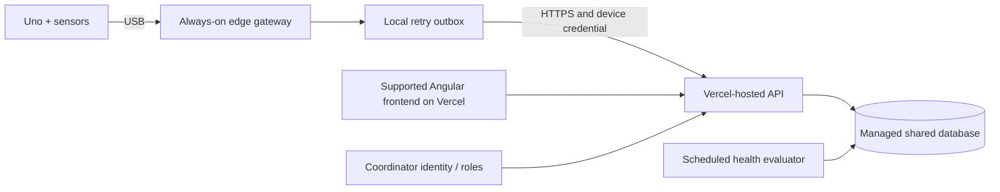

# Local operation now; Git and Vercel later

This application runs locally; keeping its source on GitHub does not deploy it. **No Vercel project, cloud database, domain, scheduled cloud job, or external notification service has been created.** The existing Arduino component-test project is preserved separately.

## Run and monitor this version

1. Use Node 22.13+ and install the locked dependencies with `npm ci`.
2. Set local `.env` values from `.env.example`. Keep the API listening on its enforced loopback address.
3. Start `npm start` in the project directory. Open `http://127.0.0.1:3000`.
4. For an Arduino, complete station provisioning, calibrate/upload the sketch, and run `npm run gateway` in a second terminal. Close other programs using the serial port.
5. Check `/api/health`, the station's latest-packet time, telemetry provenance, pending field tasks, and gateway queue/log messages.
6. Watch local disk space, especially the gateway outbox during outages and the reading ledger over long pilots. The prototype does not automatically prune the database.
7. Test a real temporary network/API outage on the bench, then confirm queued packets replay without duplicate rows. Check the station remains locally readable during the outage.

For a continuously operated Raspberry Pi pilot, run the API and gateway under an operating-system service manager with a fixed working directory, a dedicated user, appropriate serial permissions, and restart-on-failure. Keep the key in a restricted environment file. Service installation has not been performed automatically. A laptop must stay awake to function as a gateway.

### Backup and recovery

SQLite uses WAL mode. For a simple small-pilot backup, stop the API cleanly and copy the database together with any remaining `-wal` and `-shm` sidecars. A live copy of the main file alone is not a reliable backup. An operational installation should use a SQLite backup API or a validated snapshot procedure.

Stop the gateway before archiving or moving its outbox. Keep station identity associated with the archive; replays require that station's valid credential. A full or corrupt journal stops normal delivery rather than silently losing records. Resolve expired packets deliberately. Never commit a queue, backup database, `.env`, or one-time key.

After restoring, confirm colony and cat counts, station IDs, visit timestamps, and the newest telemetry timestamp before relying on the workspace. Restoration testing matters more than the existence of a backup file.

## Station rollout is separate from web deployment

The implemented lifecycle is planned → bench → deployed → maintenance → retired. The API checks deployment assertions and calibration before accepting the deployed state, and prevents two deployed stations for the same colony. It does not physically inspect a site or certify its safety.

A sensible pilot starts with a small number of permitted sites and existing caregivers. Validate food estimates against manual fill checks, wetness response against controlled tests, and missed-connection alerts against actual outages. Record time to assignment, time to verified visit, false/unknown readings, probe-cleaning frequency, and staff effort. Compare these to a baseline instead of claiming welfare impact from sensor uptime alone. See the detailed pilot plan in `COMMUNITY_RESEARCH.md`.

## Prepare for Git when requested

The project already contains `.gitignore`, `package-lock.json`, environment examples, repeatable scripts, and test fixtures. The ignore rules exclude dependencies, build artifacts, credentials, live databases, gateway queues, screenshots, and logs.

Before any future first commit, review tracked files and ensure that all included examples remain fictional and credential-free. Real colony locations and volunteer contacts do not belong in a public repository. Keep the original hardware tests and monitoring firmware versioned intentionally. No Git initialization or remote push has been run for this project.

## Vercel architecture decision

Vercel supports Express applications, but that does **not** make the current local runtime ready for cloud deployment. Its current Express documentation describes framework detection and CDN-served `public/` assets, with `express.static()` not used for cloud static serving. Check these details again when implementing the deployment. [Vercel Express documentation](https://vercel.com/docs/frameworks/backend/express).

The blocking storage difference is persistence: local SQLite files are unsuitable as the shared, durable database for serverless functions. Multiple instances do not share one permanent local database. Use a managed shared database and transactional/idempotent ingestion instead. [Vercel SQLite guidance](https://vercel.com/kb/guide/is-sqlite-supported-in-vercel).

A practical future topology:

The gateway remains with the physical hardware. A Vercel Function cannot open an Arduino USB port at a colony. Separate deployment of the frontend/API does not provide field connectivity, power, or outdoor protection.

## Work required before public hosting

1. **Framework/security:** the requested AngularJS 1.8.3 is end-of-life and currently has unfixed npm advisories. Migrate to supported Angular or make an explicit supported-distribution decision. Keep untrusted text out of HTML/expression evaluation. Existing local restrictions do not remove framework vulnerabilities. [AngularJS support notice](https://docs.angularjs.org/guide/migration).
2. **Coordinator identity and authorization:** add sign-in, colony-scoped roles, protected exports, exact-location access rules, session/CSRF handling, and retained audit history. Device credentials remain distinct from human identities. Add credential rotation/revocation and a secure provisioning workflow.
3. **Persistence migration:** replace the synchronous SQLite store and route calls with an asynchronous managed-database implementation, schema migrations, tested backups, and retention. Preserve a unique `(device_id, boot_id, sequence)` key and atomic insertion/task transitions. Make sensor-task deduplication concurrency-safe at the database level.
4. **Runtime adaptation:** supply the supported Express entry/export, package the frontend/vendor assets for CDN serving, configure trusted HTTPS origins, and make API URLs/environment handling deployment-aware. Replace the local interval with a durable scheduled health evaluator; a serverless process timer is not an uptime monitor.
5. **Transport and abuse limits:** use HTTPS, per-device rate/burst limits, bounded payloads, proper request metrics, structured redacted logs, and operational alerting for backlog/error rates. Decide how hardware/demo data is isolated in storage and access control. Disable demonstration endpoints in production.
6. **Verification:** run API/browser checks against a disposable preview database, test concurrent/replayed uploads, stale/backlogged samples, signed-in role boundaries, offline recovery, and report access. Do not use real locations or personal data in public preview environments.
7. **Release decision:** agree on hosting, storage, operating budget, responsible maintainers, and data policy; only then create the requested remote/deployment resources. No cloud services have been provisioned in this task.

Vercel's function lifecycle is request-driven and scales by invocation; durable data and scheduled monitoring need deliberate design. [Vercel Functions documentation](https://vercel.com/docs/functions).
